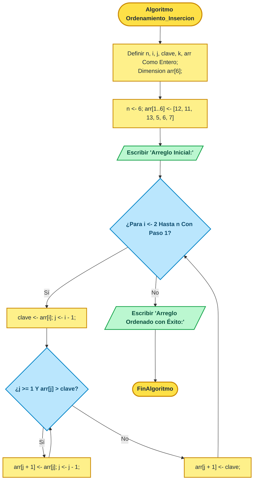

# 📐 PUNTO DE RESTAURACIÓN MAESTRO: EMULACIÓN DE DIAGRAMAS CANÓNICOS PSEINT & MERMAID.JS
> **Proyecto:** ALGO-MATRIX 3D (Enciclopedia & Laboratorio Interactivo de Algoritmos y Big-O)  
> **Lead Architect & Docente:** Ing. Juancito Peña Vizcaíno  
> **Fecha de Creación:** 31 de Octubre de 2026  
> **Archivo de Referencia Original Extraído:** [.backup/REFERENCIA_CANONICA_PSEINT_MERMAID.html](.backup/REFERENCIA_CANONICA_PSEINT_MERMAID.html) (77,225 caracteres)  
> **Propósito:** Preservar intacto el código de referencia, la técnica de construcción visual, los colores, formas y reglas para que la próxima sesión emule con 100% de fidelidad cada uno de los diagramas de los 21 algoritmos.

---

## 🎯 1. ORIGEN Y CÓDIGO DE REFERENCIA PROPORCIONADO POR EL USUARIO
El usuario suministró una aplicación web completa titulada:
`Laboratorio PSeInt Pro | Simulador, Consola y Diagramas de Flujo`
Dicho archivo ha sido extraído directamente del historial de la sesión y respaldado de manera inmutable en:
📂 **Ruta Local:** `C:\Users\User\Desktop\La Enciclopedia Interactiva de Algoritmos & Big-O\.backup\REFERENCIA_CANONICA_PSEINT_MERMAID.html`

### Características de la Referencia Original:
- **12 Ejercicios Completos en `exercisesData`** con declaración formal de tipos, pseudocódigo canónico, simulador interactivo y diagramas de flujo vectoriales de alta precisión.
- **Función Maestra `generateFlowchartSVG(id)`:** Motor procedural de renderizado de diagramas de flujo con estricta semántica de formas ISO 5807 y colores oficiales de PSeInt.
- **Función `highlightFlowchartPath(step)`:** Resaltado reactivo de las ramas y nodos del diagrama durante la ejecución paso a paso.

---

## 🎨 2. ESPECIFICACIÓN TÉCNICA DE FORMAS Y PALETA DE COLORES (ESTÁNDAR PSEINT PRO)

| Elemento / Instrucción | Forma Geométrica SVG | Sintaxis SVG | Relleno (`fill`) | Borde (`stroke`) | Color de Texto |
| :--- | :--- | :--- | :--- | :--- | :--- |
| **Inicio / Fin (`Algoritmo`, `FinAlgoritmo`)** | Óvalo / Elipse | `<ellipse cx="..." cy="..." rx="110" ry="24" .../>` | `#fde047` (Amarillo Intenso) | `#ca8a04` (2.5px) | `#1e293b` (Negro carbón) |
| **Declaraciones y Asignaciones (`Definir`, `<-`)** | Rectángulo con bordes redondeados | `<rect x="..." y="..." width="..." height="..." rx="6" .../>` | `#fef08a` (Amarillo Pastel) | `#ca8a04` (2.5px) | `#1e293b` (Negro carbón) |
| **Salida en Pantalla (`Escribir`)** | Paralelogramo Inclinado (Hacia la derecha) | `<polygon points="x1,y1 x2,y1 x3,y2 x4,y2" .../>` | `#bbf7d0` (Verde Menta) | `#16a34a` (2.5px) | `#064e3b` (Verde oscuro) |
| **Entrada por Teclado (`Leer`)** | Paralelogramo Inclinado (Entrada) | `<polygon points="x1,y1 x2,y1 x3,y2 x4,y2" .../>` | `#fbcfe8` (Rosa Suave) | `#db2777` (2.5px) | `#831843` (Magenta oscuro) |
| **Decisión Lógica (`Si / No`, `Mientras`, `Para`)** | Rombo de Decisión | `<polygon points="cx,cy-h cx+w,cy cx,cy+h cx-w,cy" .../>` | `#bae6fd` (Azul Cielo) | `#0284c7` (2.5px) | `#0c4a6e` (Azul oscuro) |
| **Conectores y Flechas** | Líneas ortogonales con marcador arrowhead | `<marker id="arrow" ...><line ... marker-end="url(#arrow)"/>` | N/A | `#334155` (Gris Pizarra 2.5px) | N/A |

### Estructura Canónica de los Marcadores de Flecha:
```xml
<defs>
  <marker id="arrow" viewBox="0 0 10 10" refX="6" refY="5" markerWidth="7" markerHeight="7" orient="auto-start-reverse">
    <path d="M 0 0 L 10 5 L 0 10 z" fill="#334155" />
  </marker>
</defs>
```

---

## 🔄 3. EQUIVALENCIA BIDIRECCIONAL: SVG CANÓNICO ⇄ MERMAID.JS (FLOWCHART TD)

Para que los diagramas se puedan renderizar tanto con **Mermaid.js** como con **SVG puro procedural**, se establece el siguiente mapeo canónico estricto:



---

## 📋 4. HOJA DE RUTA EXACTA PARA LA PRÓXIMA SESIÓN (INSTRUCCIONES DIRECTAS)

Cuando se retome la sesión o una nueva IA continúe este trabajo:
1. **Paso 1: Abrir y Estudiar `.backup/REFERENCIA_CANONICA_PSEINT_MERMAID.html`:**
   - Inspeccionar la función `generateFlowchartSVG(id)` (líneas 1200 a 1600 aprox.).
   - Revisar cómo calcula las coordenadas `cx, cy, rx, ry`, cómo distribuye los nodos verticalmente (`y` espaciados entre 45px y 70px) y cómo conecta los bucles de retorno hacia arriba.
2. **Paso 2: Auditar los Diagramas de los 21 Algoritmos en `js/algo-multilang-data.js`:**
   - Verificar que cada entrada en `langs.pseint.flowchart` posea:
     * `flowchart.mermaidCode`: Grafo `flowchart TD` completo con las 5 clases `:::terminal`, `:::proceso`, `:::salida`, `:::entrada`, `:::decision` y etiquetas en las flechas (`-- Sí -->`, `-- No -->`).
     * `flowchart.svgCode` (o `generateFlowchartSVG`): Generador vectorial con la estética del archivo de referencia.
3. **Paso 3: Validar con las 4 Suites de Calidad:**
   ```bash
   node .backup/test_multilang_v2_strict.js
   node .backup/test_multilang_system.js
   node .backup/test_simulation_engine.js
   node .backup/test_mermaid_and_pseint_syntax.js
   ```
4. **Paso 4: Comprobar la Experiencia Visual en el Navegador:**
   - Abrir el modal multi-lenguaje de cualquier tarjeta (ej. Bubble Sort, Insertion Sort, Binary Search).
   - Verificar que el diagrama se renderice nítido, sin cortes de flechas, con textos perfectamente legibles y con el botón "Copiar Mermaid" activo.

---

## 🔒 5. CONTROL DE CUSTODIA Y COMPROMISO
Este archivo garantiza que **ningún detalle estético, estructural o de contexto se perderá** entre sesiones. La referencia del usuario está asegurada en `.backup/REFERENCIA_CANONICA_PSEINT_MERMAID.html` y referenciada en el checkpoint central del proyecto.
