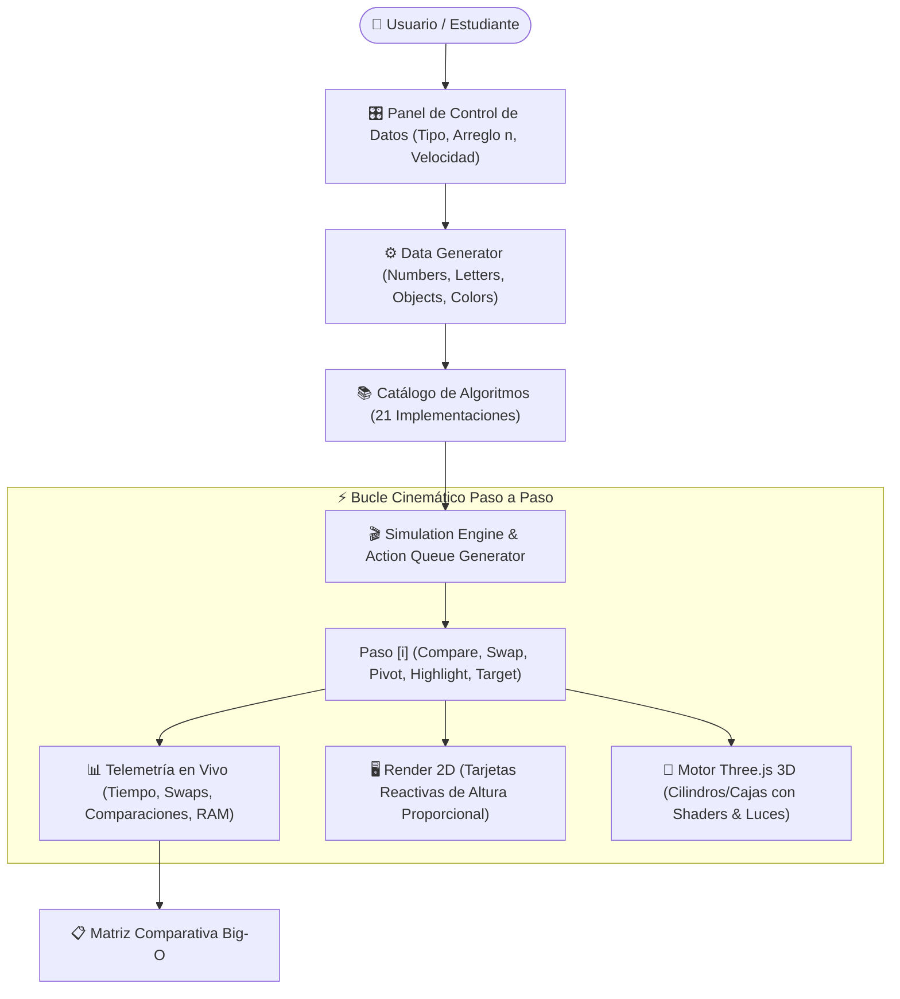

# 🧠 ALGO-MATRIX 3D: Enciclopedia & Laboratorio Interactivo de Algoritmos y Big-O

> **Plataforma Educativa de Alto Rendimiento para la Visualización Cinemática 2D/3D y Análisis de Complejidad Computacional en Tiempo Real.**  
> **Autor & Lead Architect:** [Ing. Juancito Peña Vizcaíno](https://www.linkedin.com/in/juancitope%C3%B1a/)  
> **Despliegue Oficial en GitHub Pages:** [https://juancitopena.github.io/enciclopedia-algoritmos-big-o-3d/](https://juancitopena.github.io/enciclopedia-algoritmos-big-o-3d/)

---


[](https://juancitopena.github.io/enciclopedia-algoritmos-big-o-3d/)
[](LICENSE)
[](https://threejs.org/)
[](https://tailwindcss.com/)
[](https://github.com/JUANCITOPENA/enciclopedia-algoritmos-big-o-3d)
[](https://www.youtube.com/@JuancitoDevV)

---

## 📖 1. Visión y Narrativa de Ingeniería

En el diseño de software moderno y la ingeniería de datos de alta escala, la diferencia entre un algoritmo $O(n \log n)$ y uno $O(n^2)$ no es simplemente teórica: representa la frontera entre una respuesta en **milisegundos** o el **colapso térmico y desbordamiento de memoria** de un clúster de servidores cuando el volumen de datos ($n$) escala a millones de registros.

**ALGO-MATRIX 3D** nace de la necesidad de cerrar la brecha cognitiva entre la abstracción matemática pura y la intuición visual práctica. Diseñado bajo el paradigma de diseño de alto impacto **Neo-Brutalismo Developer-First**, este sistema transforma los conceptos más rigurosos de las Ciencias de la Computación en un laboratorio vivo donde estudiantes, ingenieros y docentes pueden:

1. **Manipular dinámicamente conjuntos de datos** (números reales, caracteres alfabéticos, objetos estructurados o colores cromáticos).
2. **Inspeccionar cada micropaso cinemático** (comparación, intercambio de índices, partición de pivotes y lecturas de memoria RAM simulada).
3. **Observar la geometría del orden en 3 Dimensiones** con barras espaciales renderizadas en WebGL con sombreado de materiales físicos e iluminación especular interactiva controlada por cámara orbital.
4. **Contrastar el rendimiento real vs. el orden asintótico teórico** mediante telemetría instantánea de operaciones ejecutadas y espacio auxiliar ocupado.

---

## 🏛️ 2. Arquitectura del Sistema

El proyecto está diseñado bajo principios de **Modularidad Limpia y Desacoplamiento**, separando la estructura del documento, las directivas de presentación y el motor cinemático de simulación:

```
enciclopedia-algoritmos-big-o-3d/
├── 📄 index.html              # Maquetación semántica, Head con CDNs y Navbar Sticky
├── 🎨 style.css               # Estilos Neo-Brutalistas, viewport 3D, cápsulas y responsive grid
├── 🚀 script.js               # Motor Three.js 3D, generador de colas cinemáticas y catálogo de 21 algoritmos
├── 📁 assets/
│   └── 🖼️ LOGO_DATAIADEV.png  # Identidad visual de DataIADev en alta resolución
├── 📁 css/
│   └── 🎨 styles.css          # Réplica desacoplada para entornos empaquetados
├── 📁 js/
│   ├── ⚙️ tailwind-config.js  # Paleta de colores neoYellow, neoPink, neoCyan, sombras duras
│   └── 🚀 app.js              # Módulo de lógica de respaldo
└── 📄 README.md               # Documentación técnica maestra y manual arquitectónico
```



---

## 🧮 3. Fundamentos Matemáticos: Jerarquía de Complejidad Asintótica (Big-O)

El laboratorio incluye una suite teórica ilustrada que modela formalmente el comportamiento de los algoritmos ante el crecimiento de $n \to \infty$:

| Notación | Nombre | Comportamiento Asintótico | Impacto Real para $n = 10^6$ | Ejemplos Representativos |
| :---: | :--- | :--- | :--- | :--- |
| **$O(1)$** | **Constante** | El tiempo no depende del tamaño de entrada. | Inmediato (~1 op) | Acceso por índice en arreglo, Hash Table lookup |
| **$O(\log n)$** | **Logarítmica** | Divide el problema a la mitad en cada paso. | Ultrarrápido (~20 ops) | Búsqueda Binaria, Búsqueda Ternaria |
| **$O(n)$** | **Lineal** | El tiempo crece proporcionalmente a $n$. | Escala suave (~$10^6$ ops) | Búsqueda Lineal, Conteo, Recorrido |
| **$O(n \log n)$** | **Linealítmica** | Óptimo teórico para ordenamientos comparativos. | Excelente (~$2 \times 10^7$ ops) | Merge Sort, Quick Sort (Promedio), Heap Sort |
| **$O(n^2)$** | **Cuadrática** | Bucles anidados; crece drásticamente. | Crítico (~$10^{12}$ ops) | Bubble Sort, Selection Sort, Insertion Sort |
| **$O(2^n)$** | **Exponencial** | Se duplica con cada elemento adicional. | Inviable para $n > 40$ | Torres de Hanói, Recursión Fibonacci ingenua |
| **$O(n!)$** | **Factorial** | Permutación total del conjunto. | Computacionalmente Prohibitivo | Problema del Viajante de Comercio (Fuerza Bruta), Bogo Sort |

---

## 📚 4. Catálogo de los 21 Algoritmos Soportados

El motor cuenta con 21 algoritmos programados paso a paso con generación de estados cinemáticos explícitos:

### A. Algoritmos de Ordenamiento (9)
1. **Bubble Sort (Burbuja):** Compara parejas adyacentes e intercambia si están desordenadas hasta que los elementos mayores "flotan" al extremo derecho ($O(n^2)$).
2. **Selection Sort (Selección):** Busca iterativamente el elemento mínimo en la sublista desordenada y lo ubica en su posición definitiva ($O(n^2)$).
3. **Insertion Sort (Inserción):** Construye el arreglo ordenado insertando cada elemento en su posición relativa correspondiente, ideal para colecciones casi ordenadas ($O(n^2)$, mejor caso $O(n)$).
4. **Shell Sort:** Generalización del ordenamiento por inserción utilizando brechas decrecientes (*gaps*) basadas en la secuencia de Knuth ($O(n \log^2 n)$).
5. **Merge Sort (Mezcla):** Paradigma *Divide y Vencerás*; particiona recursivamente a la mitad y fusiona sublistas ordenadas garantizando estabilidad ($O(n \log n)$, espacio $O(n)$).
6. **Quick Sort (Lomuto):** Selecciona un pivote y particiona los elementos en menores y mayores, resolviendo recursivamente in-place ($O(n \log n)$ promedio, $O(n^2)$ peor caso).
7. **Heap Sort (Montículo):** Transforma el arreglo en un Max-Heap binario y extrae iterativamente la raíz hacia el final del arreglo ($O(n \log n)$, espacio auxiliar in-place $O(1)$).
8. **Radix Sort (LSD):** Algoritmo no comparativo que clasifica enteros procesando sus dígitos individuales desde el menos significativo al más significativo ($O(d \cdot (n + k))$).
9. **Bogo Sort (Didáctico):** Demostrador de permutación aleatoria aleatoria hasta encontrar orden por puro azar ($O((n+1)!)$).

### B. Algoritmos de Búsqueda (6)
10. **Búsqueda Lineal:** Inspección secuencial elemento por elemento desde el índice $0$ hasta encontrar el objetivo ($O(n)$).
11. **Búsqueda Binaria:** Inspección del punto medio en colecciones ordenadas, descartando la mitad del espacio de búsqueda en cada paso ($O(\log n)$).
12. **Búsqueda Ternaria:** Divide el espacio de búsqueda en tres segmentos mediante dos índices de partición ($O(\log_3 n)$).
13. **Búsqueda por Salto (Jump Search):** Avanza en bloques fijos de tamaño $\sqrt{n}$ y realiza búsqueda lineal en el bloque identificado ($O(\sqrt{n})$).
14. **Búsqueda por Interpolación:** Estima la posición del objetivo mediante fórmula lineal basada en los valores en los extremos del rango ($O(\log \log n)$ promedio).
15. **Búsqueda Exponencial:** Encuentra el rango donde reside el objetivo duplicando la cota superior exponencialmente ($2^0, 2^1, 2^2, \dots$) y luego ejecuta búsqueda binaria ($O(\log n)$).

### C. Demostradores de Complejidad Pura (6)
16. **Demostrador $O(1)$:** Acceso inmediato por cálculo de offset en puntero de memoria.
17. **Demostrador $O(n)$:** Recorrido acumulativo simple en un solo pase.
18. **Demostrador $O(n^2)$:** Comparación matricial cruzada completa (pares cartesianos).
19. **Demostrador $O(n^3)$:** Triple bucle volumétrico representativo de multiplicación de matrices clásica.
20. **Demostrador $O(2^n)$:** Simulación de ramificación de árbol binario de llamadas recursivas.
21. **Demostrador $O(n!)$:** Árbol de permutación exhaustiva factorial.

---

## 🎮 5. Características Clave de la Experiencia de Usuario

* **Doble Motor de Visualización (2D + 3D):**
  * **2D:** Tarjetas con alturas proporcionales, badges de índice, valores numéricos/alfabéticos y colores de estado (Azul: en reposo; Amarillo: comparando; Rojo: intercambio; Verde: colocado definitivamente; Naranja: pivote/objetivo).
  * **3D:** Canvas acelerado por hardware con **Three.js r128**, iluminación ambiental y direccional, sombras, base de rejilla y control orbital de cámara mediante ratón o toque táctil (rotación, paneo y zoom).
* **Telemetría en Vivo:**
  * Contador de tiempo de ejecución real en milisegundos.
  * Comparaciones de claves efectuadas en vivo vs. $f(n)$ teórico.
  * Número de intercambios (*swaps*) en memoria.
  * Accesos a memoria simulada (lecturas + escrituras).
  * Clasificación cualitativa de escalabilidad (Óptima, Aceptable, Regular, Crítica).
* **Control Cinemático Total:**
  * Botones de Reproducir / Pausar.
  * Avance paso a paso manual (Paso Siguiente / Paso Anterior).
  * Deslizador de velocidad de reloj en tiempo real (de 20 ms a 600 ms por paso).
  * Selector dinámico de tipos de datos: Números aleatorios, Letras (`A`-`Z`), Objetos con atributos y Colores cromáticos.
  * Generación rápida de presets: Arreglo Inverso (Peor Caso), Arreglo Casi Ordenado y Arreglo Aleatorio.

---

## 🛠️ 6. Stack Tecnológico

| Capa | Tecnología | Propósito |
| :--- | :--- | :--- |
| **Frontend Core** | HTML5 Semántico + ES6+ Vanilla JavaScript | Rendimiento nativo sin dependencias de compilación pesadas |
| **Estilos & UI** | Tailwind CSS Play CDN + CSS3 Personalizado | Diseño Neo-Brutalista con sombras duras (`5px 5px 0px #000`), bordes negros de 3px y paleta de alto impacto |
| **Gráficos 3D** | Three.js r128 + OrbitControls | Renderizado WebGL interactivo en 3D |
| **Iconografía** | FontAwesome 6 + Bootstrap Icons v1.11.3 | Simbología técnica, redes sociales y badges |
| **Tipografía** | Google Fonts (*Space Grotesk* y *JetBrains Mono*) | Estética técnica developer-first y legibilidad matemática |
| **Despliegue & CI/CD** | GitHub Pages | Hosting estático continuo y de alta velocidad |

---

## 🚀 7. Ejecución Local

No requiere NodeJS, Docker ni manejadores de paquetes para su visualización básica:

```bash
# 1. Clonar el repositorio
git clone https://github.com/JUANCITOPENA/enciclopedia-algoritmos-big-o-3d.git

# 2. Entrar a la carpeta del proyecto
cd enciclopedia-algoritmos-big-o-3d

# 3. Abrir en cualquier navegador moderno (Chrome, Edge, Firefox, Safari)
# En Windows:
start index.html

# En macOS:
open index.html

# En Linux:
xdg-open index.html
```

---

## 👨‍💻 8. Autor & Perfil Profesional

**Ing. Juancito Peña Vizcaíno**  
*Data Analyst · Full Stack Developer · AI & API Expert · Líder I+D+i*

* **Formación:** Ingeniero en Sistemas y Computación con Postgrado en Ingeniería de Software y Maestría en Sistemas Mención Gerencial (*Universidad Dominicana O&M*).
* **Trayectoria:** Más de 15 años de experiencia diseñando e implementando soluciones empresariales escalables, arquitecturas de datos, APIs de misión crítica y sistemas de IA Generativa (RAG / LLMs / Agentes Autónomos).
* **Docencia & Comunidad:** Creador del canal educativo **[@JuancitoDevV](https://www.youtube.com/@JuancitoDevV)**, donde comparte tutoriales avanzados sobre algoritmos, SQL, inteligencia artificial, arquitectura .NET y computación moderna.

### Conecta con el Autor:
* 💼 **LinkedIn:** [juancitopeña](https://www.linkedin.com/in/juancitope%C3%B1a/)
* 📺 **YouTube:** [@JuancitoDevV](https://www.youtube.com/@JuancitoDevV)
* 🐙 **GitHub:** [@JUANCITOPENA](https://github.com/JUANCITOPENA)
* 🐦 **X (Twitter):** [@JuancitoPenaV](https://twitter.com/JuancitoPenaV)
* 📧 **Correo Electrónico:** [juancito.pena@gmail.com](mailto:juancito.pena@gmail.com)

---

## 📄 9. Licencia

Este proyecto está distribuido bajo la licencia **MIT**. Puedes consultar el archivo [LICENSE](LICENSE) para más detalles. Si este proyecto te resulta útil para tu estudio o docencia, ¡no olvides dejarle una ⭐ al repositorio!
