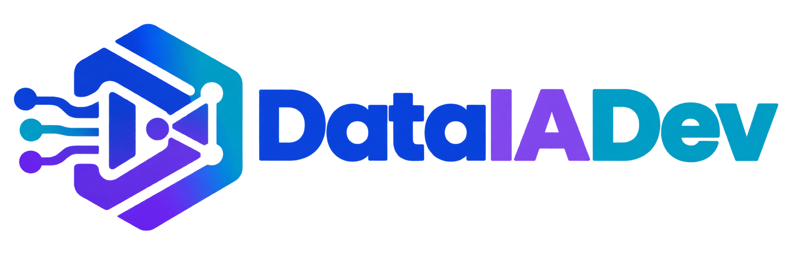
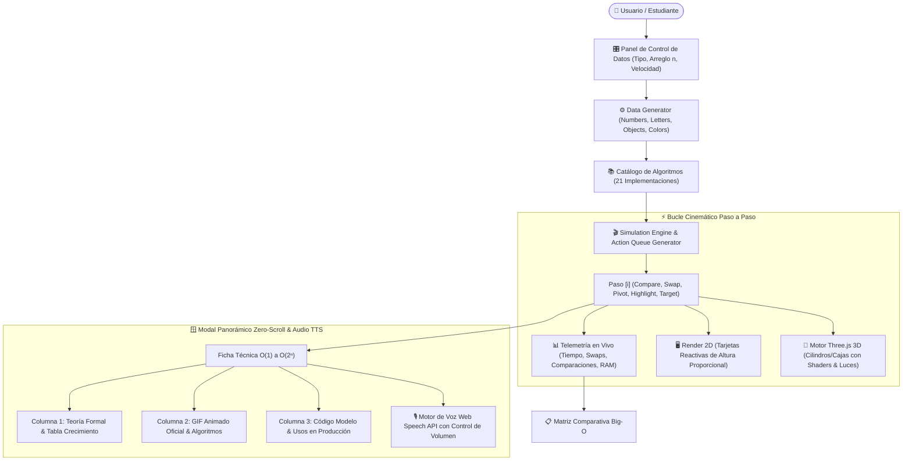

# 🧠 ALGO-MATRIX 3D: Enciclopedia & Laboratorio Interactivo de Algoritmos y Big-O

> **Plataforma Educativa de Alto Rendimiento para la Visualización Cinemática 2D/3D, Modal Panorámico Zero-Scroll, Síntesis de Voz Humana (TTS) y Análisis de Complejidad Computacional en Tiempo Real.**  
> **Autor & Lead Architect:** [Ing. Juancito Peña Vizcaíno](https://www.linkedin.com/in/juancitope%C3%B1a/)  
> **Despliegue Oficial en GitHub Pages:** [https://juancitopena.github.io/enciclopedia-algoritmos-big-o-3d/](https://juancitopena.github.io/enciclopedia-algoritmos-big-o-3d/)  
> **Checkpoint Técnico y Memoria Viva:** [ESTATUS_PROYECTO_CHECKPOINT.md](ESTATUS_PROYECTO_CHECKPOINT.md)

---



[](https://juancitopena.github.io/enciclopedia-algoritmos-big-o-3d/)
[](LICENSE)
[](https://threejs.org/)
[](https://tailwindcss.com/)
[](https://developer.mozilla.org/es/docs/Web/API/Web_Speech_API)
[](https://github.com/JUANCITOPENA/enciclopedia-algoritmos-big-o-3d)
[](https://www.youtube.com/@JuancitoDevV)

---

## 📌 Punto de Restauración y Continuidad con IA
Para cualquier agente de inteligencia artificial (Antigravity CLI, IDE o Gemini) o desarrollador que retome este proyecto, **la fuente única de verdad (Single Source of Truth) se encuentra en [ESTATUS_PROYECTO_CHECKPOINT.md](ESTATUS_PROYECTO_CHECKPOINT.md)**. Este archivo almacena el inventario de archivos, la matriz de IDs del DOM, la especificación del motor TTS y las directivas arquitectónicas para continuar inmediatamente sin tener que re-analizar el código desde cero.

---

## 📖 1. Visión y Narrativa de Ingeniería

En el diseño de software moderno y la ingeniería de datos de alta escala, la diferencia entre un algoritmo $O(n \log n)$ y uno $O(n^2)$ no es simplemente teórica: representa la frontera entre una respuesta en **milisegundos** o el **colapso térmico y desbordamiento de memoria** de un clúster de servidores cuando el volumen de datos ($n$) escala a millones de registros.

**ALGO-MATRIX 3D** nace de la necesidad de cerrar la brecha cognitiva entre la abstracción matemática pura y la intuición visual práctica. Diseñado bajo el paradigma **Neo-Brutalismo Developer-First**, este sistema transforma los conceptos más rigurosos de las Ciencias de la Computación en un laboratorio vivo donde estudiantes, ingenieros y docentes pueden:

1. **Manipular dinámicamente conjuntos de datos** (números reales, caracteres alfabéticos, objetos estructurados con pesos e IDs o colores cromáticos).
2. **Inspeccionar cada micropaso cinemático** (comparación, intercambio de índices, partición de pivotes y lecturas de memoria RAM simulada).
3. **Observar la geometría del orden en 3 Dimensiones** con barras espaciales renderizadas en WebGL con sombreado de materiales físicos e iluminación especular interactiva controlada por cámara orbital Three.js.
4. **Abrir la Ficha Panorámica Big-O con Cero Scroll** para consultar formalmente el orden asintótico, la escala de crecimiento matemático, el código modelo canónico y la animación GIF oficial.
5. **Escuchar la Explicación Magistral por Voz Humana (Web Speech TTS)** con narraciones completas que describen la teoría, el algoritmo y el comportamiento cinemático exacto de la imagen.

---

## 🏛️ 2. Arquitectura del Sistema

El proyecto está diseñado bajo principios de **Modularidad Limpia y Desacoplamiento**:

```
enciclopedia-algoritmos-big-o-3d/
├── 📄 index.html                       # Maquetación semántica, Head con CDNs, UI Neo-Brutalista y Modal Panorámico
├── ⚡ script.js                         # Motor Three.js 3D + 2D, catálogo de 21 algoritmos, BIG_O_CATALOG y motor TTS
├── 🎨 style.css                         # Estilos Neo-Brutalistas, reglas de contraste WCAG 2.2 AAA y soporte zero-scroll
├── 🏛️ ESTATUS_PROYECTO_CHECKPOINT.md     # Checkpoint técnico de restauración y memoria viva para IAs
├── 📖 README.md                         # Documentación técnica maestra y manual arquitectónico
├── 📁 assets/
│   ├── 🖼️ LOGO_DATAIADEV.png           # Identidad visual de DataIADev en alta resolución
│   ├── 📖 CATALOGO_ALGORITMOS.md        # Catálogo formal de correspondencia español / internacional
│   └── 🎬 *.gif (50 animaciones)       # Animaciones representativas de algoritmos de ordenamiento y búsqueda
├── 📁 .backup/                          # Puntos de restauración locales seguros (Aislamiento Sandbox)
└── 📁 js/ & css/                        # Módulos auxiliares desacoplados
```



---

## 🧮 3. Fundamentos Matemáticos: Jerarquía de Complejidad Asintótica (Big-O)

El laboratorio modela formalmente el comportamiento de los algoritmos ante el crecimiento de $n 	o \infty$:

| Notación | Nombre | Comportamiento Asintótico | Impacto Real para $n = 10^6$ | Ejemplos Representativos |
| :---: | :--- | :--- | :--- | :--- |
| **$O(1)$** | **Constante** | El tiempo no depende del tamaño de entrada. | Inmediato (~1 op) | Acceso por índice en arreglo, Hash Table lookup, Redis |
| **$O(\log n)$** | **Logarítmica** | Divide el problema a la mitad en cada paso. | Ultrarrápido (~20 ops) | Búsqueda Binaria, B-Trees en SQL Server/Postgres |
| **$O(n)$** | **Lineal** | El tiempo crece proporcionalmente a $n$. | Escala suave (~$10^6$ ops) | Búsqueda Lineal, Conteo, Recorrido secuencial |
| **$O(n \log n)$** | **Linealítmica** | Óptimo teórico para ordenamientos comparativos. | Excelente (~$2 	imes 10^7$ ops) | Merge Sort, Quick Sort (Promedio), Heap Sort, TimSort |
| **$O(n^2)$** | **Cuadrática** | Bucles anidados; crece drásticamente. | Crítico (~$10^{12}$ ops) | Bubble Sort, Selection Sort, Insertion Sort |
| **$O(2^n)$** | **Exponencial** | Se duplica con cada elemento adicional. | Inviable para $n > 40$ | Torres de Hanói, Recursión Fibonacci ingenua |
| **$O(n!)$** | **Factorial** | Permutación total del conjunto (NP-Hard). | Prohibitivo (> edad universo) | Problema del Viajante (Fuerza Bruta), Bogo Sort |

---

## 🪟 4. Modal Panorámico Big-O y Motor de Voz TTS (JPV Pro)

El sistema incorpora una **ventana modal interactiva de alta fidelidad** con estándar panorámico Developer-First:
* **Diseño Panorámico Zero-Scroll:** Dimensiones expandidas (`96vw` de ancho y `92vh` de alto) estructuradas en un Bento Grid de 3 columnas paralelas. Todo el contenido es 100% visible sin barras de desplazamiento vertical en pantallas de escritorio.
* **Motor Text-to-Speech (Web Speech API):**
  - **Narración Teórico-Visual Completa:** La síntesis de voz narra no solo la teoría y la ecuación matemática, sino que **describe explícitamente lo que está sucediendo en el GIF animado**, los algoritmos del grupo y los casos de uso industriales.
  - **Controles Táctiles Integrados:** Botones de Reproducir, Pausar, Reanudar y Detener con indicador visual verde pulsante (`.audio-wave-dot`).
  - **Widget de Volumen Sincronizado:** Botones de micro-ajuste `[-]` y `[+]`, control deslizante continuo de 0% a 100%, e indicador reactivo de volumen.

---

## 📚 5. Catálogo de los 21 Algoritmos Soportados

### A. Algoritmos de Ordenamiento (9)
1. **Bubble Sort (Burbuja):** Intercambios adyacentes continuos ($O(n^2)$).
2. **Selection Sort (Selección):** Búsqueda iterativa del mínimo para ubicarlo en su posición ($O(n^2)$).
3. **Insertion Sort (Inserción):** Inserción ordenada en la sublista izquierda ($O(n^2)$, mejor caso $O(n)$).
4. **Merge Sort (Mezcla):** Divide y vencerás recursivo con fusión lineal ($O(n \log n)$).
5. **Quick Sort (Rápido):** Particionamiento basado en pivote Lomuto ($O(n \log n)$ promedio).
6. **Heap Sort (Montículo):** Construcción de Max-Heap binario in-place ($O(n \log n)$).
7. **Shell Sort:** Inserción con brechas decrecientes basadas en secuencias de Knuth ($O(n \log^2 n)$).
8. **Counting Sort:** Conteo de frecuencias posicional no comparativo ($O(n + k)$).
9. **Radix Sort:** Procesamiento dígito a dígito de menor a mayor peso ($O(nk)$).

### B. Algoritmos de Búsqueda (6)
10. **Búsqueda Lineal:** Recorrido secuencial celda por celda ($O(n)$).
11. **Búsqueda Binaria:** Bisección continua y descarte del 50% ($O(\log n)$).
12. **Búsqueda en Anchura (BFS):** Exploración por niveles mediante colas FIFO ($O(V + E)$).
13. **Búsqueda en Profundidad (DFS):** Exploración de ramas hasta hojas mediante pilas LIFO ($O(V + E)$).
14. **Camino Mínimo Dijkstra:** Ruta de menor costo desde origen a todos los nodos ($O((V+E) \log V)$).
15. **Búsqueda Heurística A*:** Búsqueda informada $f(n) = g(n) + h(n)$ orientada a metas.

### C. Demostradores de Complejidad Pura (6)
16. **Demostrador $O(1)$:** Acceso inmediato por cálculo de offset en puntero de memoria.
17. **Demostrador $O(\log n)$:** Bisección de rangos continuos.
18. **Demostrador $O(n)$:** Recorrido acumulativo simple en un solo pase.
19. **Demostrador $O(n \log n)$:** Fusión dividida por niveles de árbol.
20. **Demostrador $O(n^2)$:** Comparación matricial cruzada completa (todos contra todos).
21. **Demostrador $O(2^n)$ / $O(n!)$:** Árbol de permutación y bifurcación combinatoria.

---

## 🛠️ 6. Stack Tecnológico

| Capa | Tecnología | Propósito |
| :--- | :--- | :--- |
| **Frontend Core** | HTML5 Semántico + ES6+ Vanilla JavaScript | Rendimiento nativo sin intermediación de frameworks pesados |
| **Estilos & UI** | Tailwind CSS Play CDN + CSS3 Personalizado | Diseño Neo-Brutalista con sombras duras (`5px 5px 0px #000`), bordes negros de 3px y alto contraste WCAG AAA |
| **Gráficos 3D** | Three.js r128 + OrbitControls | Renderizado WebGL interactivo en 3D con cámara orbital |
| **Motor de Audio** | Web Speech API (Nativo de navegador) | Síntesis de voz en español natural con control de volumen |
| **Iconografía** | FontAwesome 6 + Bootstrap Icons v1.11.3 | Simbología técnica, redes sociales y badges |
| **Tipografía** | Google Fonts (*Space Grotesk* y *JetBrains Mono*) | Estética técnica developer-first y legibilidad matemática |
| **Despliegue & CI/CD** | GitHub Pages | Hosting estático continuo y de alta velocidad |

---

## 🚀 7. Ejecución Local

No requiere NodeJS, Docker ni manejadores de paquetes para su visualización:

```bash
# 1. Clonar el repositorio
git clone https://github.com/JUANCITOPENA/enciclopedia-algoritmos-big-o-3d.git

# 2. Entrar a la carpeta del proyecto
cd enciclopedia-algoritmos-big-o-3d

# 3. Abrir en cualquier navegador moderno (Chrome, Edge, Firefox, Safari)
# En Windows:
start index.html

# En macOS:
open index.html

# En Linux:
xdg-open index.html
```

---

## 👨‍💻 8. Autor & Perfil Profesional

**Ing. Juancito Peña Vizcaíno**  
*Data Analyst · Full Stack Developer · AI & API Expert · Líder I+D+i*

* **Formación:** Ingeniero en Sistemas y Computación con Postgrado en Ingeniería de Software y Maestría en Sistemas Mención Gerencial (*Universidad Dominicana O&M*).
* **Trayectoria:** Más de 15 años de experiencia diseñando e implementando soluciones empresariales escalables, arquitecturas de datos, APIs de misión crítica y sistemas de IA Generativa (RAG / LLMs / Agentes Autónomos).
* **Docencia & Comunidad:** Creador del canal educativo **[@JuancitoDevV](https://www.youtube.com/@JuancitoDevV)**, donde comparte tutoriales avanzados sobre algoritmos, SQL, inteligencia artificial, arquitectura .NET y computación moderna.

### Conecta con el Autor:
* 💼 **LinkedIn:** [juancitopeña](https://www.linkedin.com/in/juancitope%C3%B1a/)
* 📺 **YouTube:** [@JuancitoDevV](https://www.youtube.com/@JuancitoDevV)
* 🐙 **GitHub:** [@JUANCITOPENA](https://github.com/JUANCITOPENA)
* 🐦 **X (Twitter):** [@JuancitoPenaV](https://twitter.com/JuancitoPenaV)
* 📧 **Correo Electrónico:** [juancito.pena@gmail.com](mailto:juancito.pena@gmail.com)

---

## 📄 9. Licencia

Este proyecto está distribuido bajo la licencia **MIT**. Puedes consultar el archivo [LICENSE](LICENSE) para más detalles. Si este proyecto te resulta útil para tu estudio o docencia, ¡no olvides dejarle una ⭐ al repositorio!
